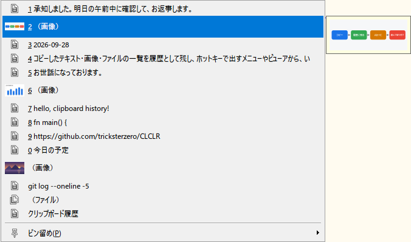
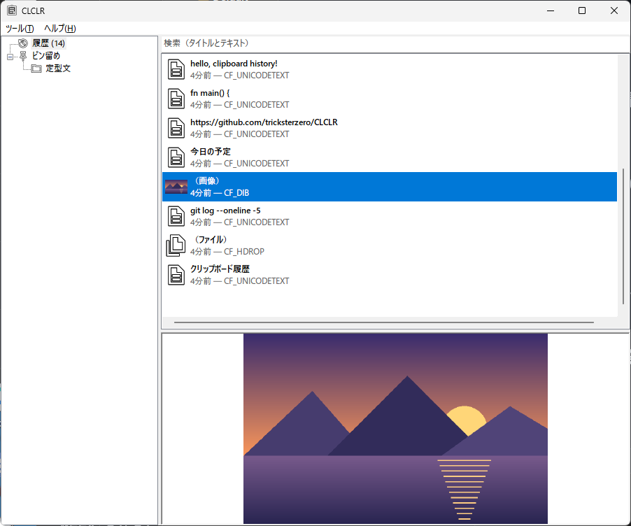
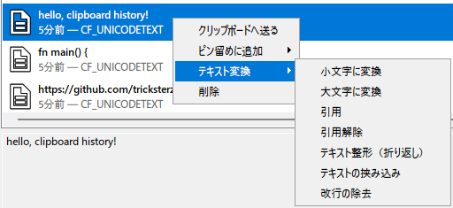

# CLCLR

Windows 用の、クリップボードの履歴を残すソフトです。コピーした文字・画像・ファイル（ファイルの場所の一覧）を履歴として覚えておき、いつでも貼り付け直せます。貼り付け直すときは、ホットキー（決めておいたキーの組み合わせ）で出すメニューか、履歴を一覧で見る画面（ビューア）を使います。

CLCL（Ohno Tomoaki 氏、MIT ライセンス。[公式サイト](https://nakka.com/soft/clcl/)・[GitHub リポジトリ](https://github.com/nakkag/CLCL)）の機能と使い勝手を手本に、Rust で作り直したものです。CLCL のソースを移植したものではなく、設計は新しく起こしています。本家との違いは「[本家 CLCL との違い](#本家-clcl-との違い)」にまとめました。

作者は CLCLR を **クルクルル**（ku-ru-ku-ru-ru）と呼んでいます。



## 動作環境

- Windows 10 / 11（64 ビット）を想定しています。動作を確かめているのは Windows 11 だけです
- 画面の表示倍率（文字などを大きく表示する設定）を変えていても、モニターごとに倍率が違っていても、それに合わせて表示します
- 画面の文字は日本語だけです。ダークモード（黒っぽい配色）には対応していません（Windows で設定されている色で表示します）

## インストール

インストーラーはありません。次の手順で使い始めます。

1. 配布の zip（`CLCLR-<バージョン>-x64.zip`）を右クリックして「すべて展開」を選び、展開します。中には `CLCLR.exe`・`README.md`・`LICENSE`・`THIRD-PARTY-NOTICES.md` が入っています
2. 展開したファイルを、書き込みできる好きなフォルダに置きます。お勧めは、自分のユーザーフォルダの中の `%LOCALAPPDATA%\Programs\CLCLR` です。エクスプローラーのアドレス欄に `%LOCALAPPDATA%` と入れると開くので、その中に `Programs` フォルダ（無ければ作ります）、さらにその中に `CLCLR` フォルダを作ります
3. `CLCLR.exe` をダブルクリックして起動します

### 置き場所の注意

- 設定と履歴は、`CLCLR.exe` と同じフォルダに保存されます（フォルダごと持ち運べる「ポータブル」の形です）。そのため、`C:\Program Files` のように、ふつうの権限では書き込めない場所には置かないでください
- 履歴にはパスワードなどが入ることがあります。ほかのアカウントから読まれないよう、自分のユーザーフォルダの中に置くことをお勧めします（下の「[置き場所と権限](#置き場所と権限)」）

### 起動とアンインストール

- `CLCLR.exe` にはデジタル署名（作者を証明する印）がありません。そのため、ダウンロードしたものを初めて起動するとき、Windows の SmartScreen が警告を出すことがあります
- Windows の起動と一緒に動かすには、`CLCLR.exe` のショートカットを、スタートアップのフォルダに置きます。スタートアップのフォルダは、エクスプローラーのアドレス欄に `shell:startup` と入れると開きます
- アンインストールは、フォルダごと消すだけです。レジストリ（Windows の設定の保存場所）は使いません
- CLCLR を2つ同時に動かすことはできません（別のフォルダに置いたものでも同じです）。2つ目を起動すると、動いている方のビューアが前に出ます

### セキュリティソフトの誤検出について

セキュリティソフトによっては、CLCLR をウイルスなどの悪いソフト（マルウェア）と誤って判定することがあります。CLCLR は、コピーした内容を覚えて貼り付け直すために次のことをしますが、これがキーボードの入力を盗み見るソフト（キーロガー）と似た動きに見えるためです。

- コピーした内容を見張る（履歴に加えるため）
- キーボードの入力を見る（Ctrl・Shift・Alt を素早く2回押したことに気づくため。この機能を使う設定にしたときだけ）
- キーを押したことにする（選んだ項目を、元の画面へ自動で貼り付けるため）

CLCLR には、インターネットなどのネットワークにつながる処理はありません。履歴と設定は、`CLCLR.exe` と同じフォルダに保存します。

## 使い方

### 常駐とトレイ

起動すると、タスクバーの通知領域（ふつうは画面の右下、時計の近く。「トレイ」とも呼びます）にアイコンが出ます。見当たらないときは、通知領域の「^」を押すと出てくる、隠れているアイコンの中にあることがあります。

起動している間は、コピーするたびに、その内容が履歴に加わります。ただし、次の内容は加わりません。

- 監視をオフにしている間にコピーした内容（監視のオン・オフは、トレイのアイコンの右クリックの「クリップボードを監視」で切り替えます）
- 設定の形式フィルタ・ウィンドウフィルタで、取り込まないことにした内容

| トレイのアイコンの操作 | 動き |
|---|---|
| 左クリック | ポップアップメニュー（下）をマウスの位置に出す |
| ダブルクリック | ビューアを出す |
| 右クリック | 「ビューアを表示」「クリップボードを監視」（監視のオン・オフ）「終了」のメニューを出す |

ビューアの「×」で閉じても、CLCLR は終了せず、トレイに隠れて動き続けます。終了するときは、トレイのアイコンを右クリックして「終了」を選びます。トレイのアイコンを出さない設定にしているときは、ビューアを閉じると終了します。

### ポップアップメニュー

ホットキー（既定は **Alt+C**。Alt キーを押しながら C キーを押します）で、いま文字を入力している位置の近くにメニューが出ます。入力している位置が分からないときは、マウスの位置に出ます。

- 履歴が、上から新しい順に並びます（既定は20件）。先頭の10件は、数字のキー（`1`〜`9`・`0`）を押しても選べます
- ピン留め（下の「[ピン留め](#ピン留め)」）は、「ピン留め(P)」の中にまとまります。ピン留めのフォルダは、さらにその中のメニューになります。設定で、ピン留めを履歴より上に出すこともできます
- 項目を選ぶと、その内容がクリップボードに入り、元の画面へ自動で貼り付けます。Shift キーを押しながら選ぶと、貼り付けはせず、クリップボードに入れるだけにします
- 項目にマウスを合わせるか、矢印キーで選んで、しばらく待つと、中身を小さな窓で確かめられます。文字は既定で1,024文字・20行まで、画像は縮小した絵、ファイルは名前の一覧を出します

Ctrl・Shift・Alt のそれぞれについて、素早く2回押したとき（二度押し）に、メニューやビューアを出すようにもできます（既定ではどれも無効）。メニューは「履歴とピン留め」「ピン留めのみ」「履歴のみ」から選べます。

ホットキーと二度押しでメニューを出す位置は、設定の「ホットキー」タブの「メニューを出す位置」で選べます（トレイのアイコンから出すメニューは、いつもマウスの位置です）。

- **入力位置（より多くのアプリで探す）**（既定）: ふつうの方法では入力位置が分からないアプリ（Chrome や Firefox などのブラウザ、Discord、Windows Terminal など）でも、入力位置を探します。探すのには、UI Automation（Windows が読み上げソフトなどのために用意している仕組み）を使います
- **入力位置（従来の方法）**: ふつうの方法（Windows に知らされる、文字のカーソルの位置）だけで探します。v1.3.0 までの動きです。上のようなアプリでは、マウスの位置に出ます
- **マウスの位置**: いつもマウスの位置に出します

#### 「入力位置（より多くのアプリで探す）」の注意

- 前に出ているアプリが固まっている（応答しない）ときは、メニューが出るまで 0.4 秒ほどかかることがあります
- 実際の入力位置とずれた位置を返すアプリがあります。そのため、入力欄の外を指す位置は使わず、マウスの位置に出します（VS Code の既定の設定では、こうしてマウスの位置に出ることを、1.141.0 で確かめています）
- 位置を聞かれたアプリの側でも、答えるための処理が動きます。Chrome・Edge など、Chromium という部品を使うアプリは、読み上げソフトなどのための機能を、必要になったときに有効にする作りです。CLCLR が位置を聞くことで、そうしたアプリの動きや使うメモリが変わるかは確かめていません。気になるときは「入力位置（従来の方法）」に切り替えてください

### ビューア

履歴とピン留めを一覧で見て、操作する画面です。トレイのアイコンをダブルクリックすると出ます。

- 左がツリーです。「履歴」とその階層表示のフォルダ（古い履歴をまとめたもの。設定でオンにしたとき）、「ピン留め」とそのフォルダが並びます
- 右上が一覧、右下がプレビュー（選んだ項目の中身）です
- それぞれの境目は、ドラッグして動かせます

ビューアの大きさと位置は覚えておき、次に起動したときに同じ所に出します（隠すときと終了するときに覚えます。最大化・最小化していたときは、その前の大きさと位置です）。

- 前の位置がどのモニターにも重ならないとき（モニターを外したときなど）は、Windows が決める位置に出ます
- 一部が画面からはみ出すときは、タスクバーを除いた範囲に収まるように動かします（起動したときと、ビューアを出す操作をしたとき。表示している間の操作も含みます）。ビューアを出す操作は、トレイのアイコンのダブルクリックや「ビューアを表示」、二度押しなどです。タイトルバーがタスクバーの下に隠れてつかめなくなっても、ビューアを出す操作をすれば戻ります



| 操作 | 動き |
|---|---|
| Enter・ダブルクリック | 選んだ項目をクリップボードへ送る（クリップボードに入れるだけで、貼り付けはしない）。ピン留めのフォルダなら、そのフォルダを開く |
| Delete | 選んだ項目を消す（ピン留めのフォルダは、確かめてから中身ごと消す） |
| F2 | ピン留めの項目・フォルダの名前を変える |
| Alt+↑・Alt+↓ | ピン留めの項目・フォルダを上・下へ動かす |
| ドラッグ | ピン留めの項目・フォルダを動かす。履歴の項目を、ツリーの「ピン留め」かそのフォルダへ落とすと、ピン留めに追加する（詳しくは「[ピン留め](#ピン留め)」）。Esc キーか右クリックで取りやめる |
| Ctrl+F | 検索欄へ移る |
| 右クリック（キーボードでは Shift+F10） | 項目のメニュー（下）を出す |

一覧の項目を右クリックすると、次のメニューが出ます（項目の種類によって、出るものが変わります）。

- クリップボードへ送る
- ピン留めに追加（履歴の項目。ピン留めにフォルダがあれば、入れる先を選びます）
- 移動・上へ・下へ・名前の変更（ピン留めの項目）
- 画像を関連付けで開く・画像を書き出してフォルダで表示（画像の項目。一時フォルダ `%TEMP%\CLCLR` に書き出した写しを使うので、開いた画像を編集しても履歴は変わりません）
- テキスト変換（テキストの項目。下の「[テキスト変換](#テキスト変換)」）
- 削除

ピン留めのフォルダの行を右クリックしたときのメニューは、開く・移動・上へ・下へ・名前の変更・削除です。

検索欄に文字を入れると、名前とテキストの全文から探して、一覧を絞り込みます。履歴を表示しているときは履歴の全部から、ピン留めを表示しているときはピン留めの全部から探します。

メニューバーの「ツール」には、設定・履歴のクリア・クリップボードのクリア・データのチェック・最前面に表示があります。

### ピン留め

よく使う内容を、履歴とは別にとっておく場所です（本家の「登録アイテム」にあたります）。ピン留めに追加すると、その写しが作られます。そのため、元の履歴が新しい履歴に押し出されたり、消されたりしても、ピン留めには残ります。

ピン留めに追加するには、ビューアで履歴の項目を右クリックして「ピン留めに追加」を選びます。履歴の項目を、左のツリーの「ピン留め」かそのフォルダへドラッグしても、そこの末尾に追加できます（検索で絞り込んでいる間もできます）。

#### フォルダの作成

- ツリーの「ピン留め」を右クリックすると、フォルダを作れます
- フォルダを右クリックすると、その中へのフォルダの作成・名前の変更・削除ができます

#### 並べ替え

- ピン留めを表示しているときの一覧には、項目と一緒にフォルダも並びます
- 項目もフォルダも、「上へ」「下へ」（右クリック、または Alt+↑・Alt+↓）で並べ替えられます。この順が、メニューの並びになります
- 検索で絞り込んでいる間は、並べ替えられません

#### 一覧の項目・フォルダのドラッグ

- 一覧の行と行の間で離すと、その位置へ入ります
- 一覧のフォルダの行の真ん中か、左のツリーのフォルダ（「ピン留め」を含む。いま一覧に表示しているフォルダは除く）の上で離すと、そのフォルダの末尾へ入ります
- 右クリックの「移動」でも、ほかのフォルダへ移せます
- フォルダは中身ごと動きます。フォルダを、それ自身やその中へは入れられません。入れる先に同じ名前のフォルダがあるときも、移せません
- 検索で絞り込んでいる間は、ドラッグできません

#### ツリーのフォルダのドラッグ

- ツリーのほかのフォルダ（「ピン留め」を含む）の上で離すと、その末尾へ入ります
- 右の一覧の行と行の間で離すと、一覧に表示しているフォルダの、その位置へ入ります。一覧のフォルダの行の上で離すと、そのフォルダの中へ入ります
- 一覧に表示しているのがそのフォルダ自身かその中のときと、検索で絞り込んでいる間は、一覧の上には落とせません（ツリーの上へは落とせます）

#### 名前と日時

- ピン留めの項目には、名前を付けられます（F2 か、右クリックの「名前の変更」）。名前を空にすると、テキストの1行目に戻ります。画像のように文字の無い項目は、名前を付けておくとメニューで見分けやすくなります
- 設定の「テキスト変換」タブで、ピン留めの項目を送るときに `%d`・`%t` を今日の日付・今の時刻に置き換えるようにできます

### テキスト変換

テキストの項目を右クリックして「テキスト変換」を選ぶと、変換した結果をクリップボードへ送ります。元の項目は変わりません。結果は、ふつうにコピーしたときと同じく監視で取り込まれ、新しい履歴として加わります。



- 小文字に変換・大文字に変換
- 引用（各行の頭に引用符を付ける）・引用解除
- テキスト整形（決めた幅で折り返す）
- テキストの挟み込み（前後に決めた文字列を付ける）
- 改行の除去

引用符・折り返しの幅・挟み込む文字列は、設定の「テキスト変換」タブで変えられます。

### データのチェック

ビューアのメニューバーの「ツール」→「データのチェック」で、保存したファイルどうしの食い違いを調べます。見つけるのは次の3つです。

- `blobs` フォルダの中で、どこからも使われていないデータのファイル
- データのファイルが無くなった項目
- 書き込みの途中で残った一時ファイル（`blobs` フォルダの中の一時ファイルと、`history.toml.tmp`・`pinned.toml.tmp`）

見つかったものは、確かめたうえで消せます。CLCLR が作る名前の形でないファイルは、見つけても消しません。調べるのは、ファイルがあるかどうかと、どこから使われているかだけです。ファイルの中身が壊れているかまでは調べません。

## 設定

ビューアのメニューバーの「ツール」→「設定」で開きます。「OK」を押すと保存され、その場で反映されます。いくつかの項目は、次に起動したときから効きます（そのことは設定画面に書いてあります）。

| タブ | 主な項目 |
|---|---|
| 全般 | クリップボードの監視、起動時のクリップボードの同期、トレイのアイコン、起動時にビューアを出さない、操作の失敗の知らせ、起動時の保存先のフォルダの権限の確認 |
| 履歴 | 最大件数（既定 30、0 は無制限。古い履歴をフォルダにまとめる設定を使うときは、そちらの件数が上限になる）、古い履歴をフォルダにまとめる（階層表示）、保存のしかた、重複のチェック、送った内容を履歴に加えない、追加の音 |
| ホットキー | メニューのホットキー、修飾キー（Ctrl・Shift・Alt）の二度押し、メニューを出す位置、メニューに出す履歴の件数、ピン留めを上に出す、ツールチップ（中身を見せる小さな窓）、自動の貼り付け |
| テキスト変換 | 引用符、折り返しの幅、挟み込む文字列、改行の除去のしかた、日時の置き換え |
| 形式フィルタ | 取り込むクリップボードの形式（データの種類）、保存するか、大きさの上限、1回のコピーの合計の上限（既定 320MiB）。既定で取り込むのは、テキスト（CF_UNICODETEXT。上限 32MiB）・画像（CF_DIB。上限 256MiB）・ファイル（CF_HDROP。ファイルの場所の一覧の大きさで、上限 1MiB） |
| ウィンドウフィルタ | コピー元の窓（タイトル・クラス名）で、取り込まない窓を決める。次のどれかの窓が当たれば取り込まない: コピーの知らせを受けたとき（コピーの直後）に前に出ている窓、取り込むときに前に出ている窓、クリップボードの持ち主の窓 |

大きさの単位の MiB は、MB（メガバイト）とほぼ同じ大きさです（1MiB は 1,048,576 バイト）。

### 履歴の保存のしかた

- 履歴のデータの本体（`blobs` フォルダの中）は、取り込んだときに書きます
- 履歴の一覧（`history.toml`）は、既定では終了のときにまとめて書きます（削除などで一覧が変わったときも書きます）
- 「変更の都度履歴を保存する」をオンにすると、取り込むたびに一覧も書きます
- 「終了時に履歴を保存する」と「変更の都度履歴を保存する」の両方をオフにすると、履歴をファイルに書かない「完全メモリモード」になります（ピン留めはいつも保存します）

### 設定ファイル

設定は `config.toml`（TOML 形式の、文字だけで書かれたファイル）に保存されるので、メモ帳などで直接直すこともできます。直すときは、CLCLR を終了してからにしてください。

### 形式フィルタの大きさの上限

形式フィルタの大きさの上限は、とても大きなコピーで、メモリやディスクを使い切らないためのものです。

- **形式ごとの上限**: これより大きな形式は取り込みません。上の表の既定の値（32MiB・256MiB・1MiB）は、設定ファイルを新しく作ったときの値です。以前のバージョンから使っている設定ファイルでは 0（無制限）のままのことがあるので、必要に応じて、設定の「形式フィルタ」タブで上限を入れてください
- **コピーの合計の上限**: 1回のコピーで取り込む形式の大きさを足した値がこれを超えると、そのコピーは何も取り込まず、そのことを知らせます（ビューアを隠していれば、ビューアを出します）。足すのは、形式ごとの上限を超えなかった形式だけです。0 は無制限です。既定の 320MiB は、以前のバージョンから使っている設定ファイルにも効きます
- **画像を送れる大きさ**: 合計の上限を既定の 320MiB より上げると、取り込めても、クリップボードへ送れない画像が出ることがあります。送れるのは、およそ1億3,400万画素（画素を RGBA に換算して 512MiB）までの画像です。既定のままなら、取り込んだ画像はどれも送れます

## データの置き場所

どれも `CLCLR.exe` と同じフォルダにあります。

| ファイル | 中身 |
|---|---|
| `config.toml` | 設定 |
| `history.toml` | 履歴の一覧（名前・日時・形式など） |
| `pinned.toml` | ピン留めの一覧とフォルダ |
| `blobs\` | 履歴とピン留めのデータの本体。画像は WebP（画質を落とさない圧縮の形式）で保存します（WebP にできない形式の画像と、幅か高さが 16383 ピクセルを超える画像は、そのまま保存します） |
| `panic.log` | 予期しないエラーで止まったときの記録（止まったときにだけ作られます） |

バックアップを取るときや、別の PC へ移すときは、CLCLR を終了してから、このフォルダごとコピーしてください。

### 置き場所と権限

CLCLR は、コピーした内容の履歴（パスワードなどを含むことがあります）を、暗号化せずにこのフォルダへ保存します。ほかのアカウント（この PC にサインインできるほかの人）がこのフォルダを読み書きできると、履歴を読まれたり、`CLCLR.exe` を別のものに差し替えられたりするおそれがあります。

そのため、自分のユーザーフォルダの中（例: `%LOCALAPPDATA%\Programs\CLCLR`。作り方は「[インストール](#インストール)」）に置くことをお勧めします。Windows の既定の設定では、`C:\` の直下に自分で作ったフォルダ（例: `C:\Tools`）とその中は、この PC にサインインできるすべてのアカウントが変更できます。

設定の「全般」タブの「起動時に保存先のフォルダの権限を確かめる」をオンにすると（既定はオフ）、起動するたびに、このフォルダの権限（だれが読み書きできるか）を確かめます。

- 確かめるのは、このフォルダと中のファイル、ドライブのルート（`C:\` など）までの親のフォルダです
- 自分・SYSTEM・Administrators・TrustedInstaller 以外のアカウントに、読み書き・差し替え・権限の変更が許されていれば、警告します（起動時にビューアを出さない設定でも、ビューアを出します）
- ネットワーク上のフォルダ、FAT・exFAT のドライブ、リンクを経由する場所は、確かめられないことを知らせます
- CLCLR が権限を変えることはありません

警告が出たら、警告の「詳細」の「見つかったこと」を見て、次のどちらかで直します。

1. **ユーザーフォルダの中へ移す（お勧め）**: CLCLR を終了し（トレイのアイコンの右クリックの「終了」）、フォルダごと自分のユーザーフォルダの中へ移します。ショートカット（スタートアップに置いたものを含む）は、移した先の `CLCLR.exe` を指すように作り直します
2. **権限を自分だけにする（コマンドの操作に慣れた方向け）**: 「見つかったこと」に、`CLCLR.exe` のあるフォルダより上のフォルダが出ていないときだけ使えます（移した後も警告が残るときを含みます）。上のフォルダが出ているときは、この方法では警告は消えないので、1. で移してください。

   CLCLR を終了し、コマンドプロンプトで次を実行します。`<フォルダ>` は `CLCLR.exe` のあるフォルダです。ほかのソフトと同じフォルダで行うと、そのソフトの権限も変わります。このコマンドは、親のフォルダから引き継いでいる権限を外し、自分・SYSTEM・Administrators に許可を付けます。直接付けてある許可は残ります
   ```
   icacls "<フォルダ>" /inheritance:r /grant:r "%USERNAME%:(OI)(CI)F" "*S-1-5-18:(OI)(CI)F" "*S-1-5-32-544:(OI)(CI)F"
   ```

直した後に起動して、警告が出ないことを確かめてください。意図してほかのアカウントと共有しているときは、警告の「今後は確かめない」を選ぶか、設定で確認を止めます。

この確認には限りがあります。確かめるのは許可の設定だけで、拒否の設定を含めた実際のアクセスや、OneDrive などの同期先での公開範囲は見ません。改ざんを見つける仕組みでもありません（設定ファイルを書き換えられる人は、確認を止められます）。

## 本家 CLCL との違い

この節は、本家 CLCL を使ったことがある方に向けた説明です。本家を使ったことがない方は、読み飛ばしてかまいません。

CLCLR は、CLCL の使い方（Alt+C のメニュー、ビューア、登録アイテム、テキスト変換、フィルタ）を保ったまま作り直すことを目指しています。本家のソースを移植したものではないので、中の作りは別物です。

### 変わったところ

- **exe 1つで動く**: 本家は `CLCL.exe`・`CLCLHook.dll`・`CLCLSet.exe`（とプラグインの DLL）の組ですが、CLCLR は `CLCLR.exe` 1つです。設定画面も本体にあります。64 ビットのネイティブの exe です
- **キーフックの DLL を使わない**: 本家はキーボードのフックに DLL（`CLCLHook.dll`）を使います。CLCLR は、自分のプロセスの中の低レベルのキーボードフック（`WH_KEYBOARD_LL`）で、修飾キーの二度押しを見ます。フックを張るのは、二度押しを使う設定のときだけです
- **設定と履歴の一覧はテキストファイル**: 本家の `clcl.ini`・`history.dat`（独自のバイナリ形式）に代わって、TOML 形式のテキストファイルに保存します
- **画像を圧縮して保存する**: 画像は WebP の可逆圧縮（画質を落とさない圧縮）で保存します。画面のスクリーンショットのような画像では、ファイルがずっと小さくなります（下の「[実測](#実測)」）
- **保存先はいつも exe の隣**: 本家は既定では `%LOCALAPPDATA%\CLCL` に保存し、ポータブルにする設定があります。CLCLR はいつもポータブルです

本家のプラグインのうち、次のものにあたる機能は本体に入っています。プラグインの仕組みそのものはありません。

- テキスト変換（tool_text）
- 履歴の階層表示（tool_history）。一覧の見せ方を変えるだけで、保存している履歴は組み替えません
- 履歴のクリアや最前面などの便利機能（tool_utl）

細かなところでは、次の点が違います。

- ビューアの検索は、入れた文字で一覧をその場で絞り込む形です（名前とテキストの全文が対象）
- テキスト変換は元の項目を変えず、結果が新しい履歴になります
- メニューのツールチップには、テキストと画像のサムネイルを並べて出します

### 実測

どれも、同じ PC（Windows 11）で、同じ測り方で測った1つの例です。環境によって変わります。

| 項目 | CLCLR | 本家 CLCL 2.1.3（32 ビット） | 条件 |
|---|---|---|---|
| 常駐のメモリ（ワーキングセット） | 約 17.4MB | 約 14.7MB | 履歴が空、ビューアを出さずに常駐、起動から60秒後。5回の中央値（2026-09-27） |
| 常駐のメモリ（プライベート） | 約 5.5MB | 約 4.5MB | 同上 |
| 本体の大きさ | 約 2.0MB（`CLCLR.exe` 1つ） | 約 1.2MB（`CLCL.exe`・`CLCLHook.dll`・`CLCLSet.exe` の合計） | CLCLR 1.0.0 と本家 2.1.3 |
| 画像25件を保存したときの大きさ | 約 22MB | 約 206MB | 1920×1080 の、画面のような模様（文字のような細かい点を含む）の合成画像（2026-09-27） |

常駐のメモリは本家よりわずかに多く、「本家より軽い」とは言えません。画像を保存したときの大きさの差は、圧縮の効きやすい画像での例です。写真のような画像では、差はずっと小さくなるはずです（実測していません）。

### 開発言語による違い

本家は C 言語、CLCLR は Rust で書かれています。Rust は、C で起きやすいメモリの扱いの誤り（使い終わったメモリをまた使う、決めた範囲の外を読み書きする、など）を、作る段階や動いている間に見つけて防ぐ仕組みを持つ言語です。そのため、そうした誤りで動きやデータがおかしくなることが起きにくくなっています。ただし、Windows の機能を直に呼ぶ部分はこの仕組みの外にあります。そこでは、外から来るデータの大きさを読む前に調べるといった確認の処理を組み込んだうえで、作る側の点検とテストで正しさを確かめています。

予期しないエラーで処理が止まったときは、`panic.log` に記録が残ります。

もっと詳しい説明は、開発者向けの情報（[DEVELOPMENT.md](https://github.com/tricksterzero/CLCLR/blob/main/DEVELOPMENT.md)。配布の zip には入っていません）にあります。

### 本家にあって CLCLR に無いもの

- プラグイン（ツール・形式の DLL）の仕組み
- ビューアでの項目の中身の編集、複数の項目をまとめての操作（複数を選んでも、先頭の1つだけが対象）
- ほかのアプリとのドラッグ＆ドロップ、右ボタンでのドラッグ（CLCLR のドラッグは、ビューアの一覧の行とツリーのピン留めのフォルダを、左ボタンでつかむものだけ）
- クリップボードの形式のバイナリ表示、画像の PNG・JPEG での保存（CLCLR の画像の書き出しは WebP か BMP）
- RTF・メタファイルなどの形式の表示（本家では、形式のプラグインを足すと表示できる）
- 登録アイテムごとのホットキー、窓ごとのコピー・貼り付けのキーの設定、メニューの表示の書式、コマンドラインの引数
- 英語の画面

### データの互換性

本家の履歴（`history.dat`）・登録アイテム・設定（`clcl.ini`）は読み込めません。CLCLR は空の履歴から始まります。

本家と同時に動かすときは、ホットキーと二度押しが重ならないように、どちらかの設定を変えてください（Alt+C は、先に起動した方が使います）。

## 既知の制限

- ダークモードの配色、読み上げソフト・ハイコントラストへの対応は考えていません
- 画面の文字は日本語だけです
- Windows 10 では動作を確かめていません
- 設定画面の大きさは変えられません。縦の解像度が小さい画面で表示倍率を大きくすると、設定画面の上下が画面からはみ出します（1920×1080 のモニターでは、175% 以上ではみ出すことを確かめています）

## 不具合の報告・要望

不具合の報告や要望は、次のどれかまでお寄せください。

- 作者へのメール: [mail@tszero.jp](mailto:mail@tszero.jp)
- [このリポジトリの Issues](https://github.com/tricksterzero/CLCLR/issues)
- [作者のX（Twitter）アカウント](https://x.com/tsZ)

## ライセンス

無料で使えるフリーソフトで、MIT ライセンスです（[LICENSE](LICENSE)）。本家 CLCL（MIT）、アイコン（Google の Material Symbols、Apache License 2.0）、組み込んでいる Rust のクレートの表示は [THIRD-PARTY-NOTICES.md](THIRD-PARTY-NOTICES.md) にあります。

## 開発者向けの情報

ソースからのビルドの方法と、開発言語についての補足は、[DEVELOPMENT.md](https://github.com/tricksterzero/CLCLR/blob/main/DEVELOPMENT.md) にあります（配布の zip には入っていません）。
