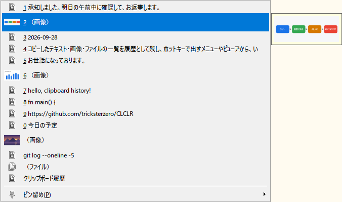
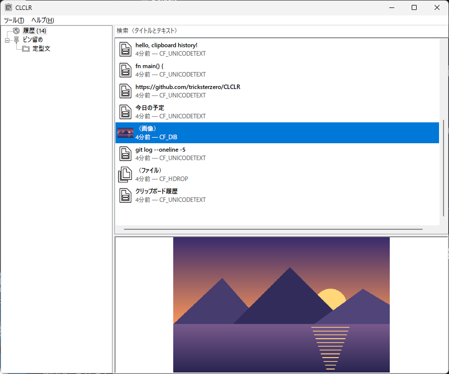
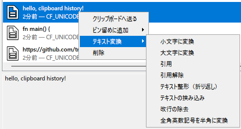

# CLCLR

Windows 用の、クリップボードの履歴を残すソフトです。コピーした文字・画像・ファイル（ファイルの場所の一覧）を履歴に残し、ホットキー（決めておいたキーの組み合わせ）で出すメニューや、履歴を一覧で見る画面（ビューア）から、いつでも貼り付け直せます。

CLCL（Ohno Tomoaki 氏、MIT ライセンス。[公式サイト](https://nakka.com/soft/clcl/)・[GitHub リポジトリ](https://github.com/nakkag/CLCL)）の機能と使い勝手を手本に、Rust で作り直したものです。ソースの移植ではなく、設計は新しく起こしています。本家との違いは「[本家 CLCL との違い](#本家-clcl-との違い)」にまとめました。

作者は CLCLR を **クルクルル**（ku-ru-ku-ru-ru）と呼んでいます。



## 動作環境

- Windows 10 / 11（64 ビット）を想定しています。動作を確かめているのは Windows 11 だけです
- 画面の表示倍率に合わせて表示します（モニターごとに倍率が違っていても合わせます）
- 画面の文字は日本語だけです。ほかの制限は「[既知の制限](#既知の制限)」にあります

## インストール

インストーラーはありません。

1. 配布の zip（`CLCLR-<バージョン>-x64.zip`）を右クリックし、「すべて展開」で展開します。中身は `CLCLR.exe`・`README.md`・`LICENSE`・`THIRD-PARTY-NOTICES.md` です
2. 展開したファイルを、書き込みできる好きなフォルダに置きます。お勧めは自分のユーザーフォルダの中の `%LOCALAPPDATA%\Programs\CLCLR` です。エクスプローラーのアドレス欄に `%LOCALAPPDATA%` と入れて開き、その中に `Programs\CLCLR` フォルダを作ります（`Programs` が無ければそれも作ります）
3. `CLCLR.exe` をダブルクリックして起動します

### 置き場所の注意

- 設定と履歴は `CLCLR.exe` と同じフォルダに保存します（フォルダごと持ち運べる「ポータブル」の形）。`C:\Program Files` など、ふつうの権限では書き込めない場所には置かないでください
- 履歴にはパスワードなどが入ることがあるので、ほかのアカウントから読まれないよう、自分のユーザーフォルダの中に置くことをお勧めします（「[置き場所と権限](#置き場所と権限)」）。「履歴に残さないで」のフラグの付いたコピーは取り込みません（「[履歴に残さないコピー](#履歴に残さないコピー)」）

### 起動とアンインストール

- `CLCLR.exe` にはデジタル署名（作者を証明するもの）が無いため、ダウンロードしたものを初めて起動するとき、Windows の SmartScreen が警告を出すことがあります
- Windows と一緒に起動するには、エクスプローラーのアドレス欄に `shell:startup` と入れて開くフォルダ（スタートアップ）に、`CLCLR.exe` のショートカットを置きます
- アンインストールはフォルダごと消すだけです。レジストリ（Windows の設定の保存場所）は使いません
- CLCLR は2つ同時には動きません（別のフォルダに置いたものでも同じ）。2つ目を起動すると、動いている方のビューアが前に出ます

### セキュリティソフトの誤検出

セキュリティソフトによっては、CLCLR をマルウェア（ウイルスなどの悪いソフト）と誤って判定することがあります。CLCLR の次の動きがキーボードの入力を盗み見るソフト（キーロガー）に似て見えるためです。

- コピーした内容を見張る（履歴に加えるため）
- キーボードの入力を見る（Ctrl・Shift・Alt を素早く2回押したことに気づくため。この機能を使う設定にしたときだけ）
- キーを押したことにする（選んだ項目を、元の画面へ自動で貼り付けるため）

CLCLR にはネットワークにつながる処理は無く、履歴と設定は `CLCLR.exe` と同じフォルダに保存します。

## 使い方

### 常駐とトレイ

起動すると、タスクバーの通知領域（ふつうは画面の右下、時計の近く。「トレイ」とも呼びます）にアイコンが出ます。見当たらないときは、通知領域の「^」で出る、隠れているアイコンの中を見てください。

起動している間は、コピーするたびに内容が履歴に加わります。ただし、監視をオフにしている間のコピーと、設定の形式フィルタ・ウィンドウフィルタで除いた内容は加わりません。監視のオン・オフはトレイのアイコンの右クリックの「クリップボードを監視」で切り替えます。

| トレイのアイコンの操作 | 動き |
|---|---|
| 左クリック | ポップアップメニュー（下）をマウスの位置に出す |
| ダブルクリック | ビューアを出す |
| 右クリック | 「ビューアを表示」「クリップボードを監視」「終了」のメニューを出す |

ビューアを「×」で閉じても CLCLR は終了せず、トレイで動き続けます。終了するには、トレイのアイコンの右クリックで「終了」を選びます。トレイのアイコンを出さない設定のときは、ビューアを閉じると終了します。

### ポップアップメニュー

ホットキー（既定は **Alt+C**）で、いま文字を入力している位置の近くにメニューが出ます。入力位置が分からないときは、マウスの位置に出ます。

- 履歴が新しい順に並びます（既定は20件）。先頭の10件は数字のキー（`1`〜`9`・`0`）でも選べます
- ピン留め（「[ピン留め](#ピン留め)」）は「ピン留め(P)」の中に、ピン留めのフォルダはさらにその中のメニューにまとまります。設定で、ピン留めを履歴より上に出すこともできます
- 項目を選ぶと、その内容をクリップボードに入れ、元の画面へ自動で貼り付けます。Shift キーを押しながら選ぶと、クリップボードに入れるだけにします
- Ctrl キーを押しながら選ぶ（クリックか Enter キー）と、テキストだけを送ります（「[書式付きの文章を取り込む](#書式付きの文章を取り込む)」）。テキストの無い項目はそのまま送ります。Ctrl キーを押しながら数字のキーを押しても選べないので、矢印キーで選んでから Ctrl+Enter を押してください。Shift キーも一緒に押すと、テキストだけをクリップボードに入れ、貼り付けはしません
- 項目にマウスを合わせるか矢印キーで選んで少し待つと、中身を小さなウィンドウで確かめられます。文字は既定で1,024文字・20行まで、画像は縮小した絵、ファイルは名前の一覧を出します

Ctrl・Shift・Alt のそれぞれを素早く2回押したとき（二度押し）に、メニューかビューアを出すこともできます（既定ではどれも無効）。メニューは「履歴とピン留め」「ピン留めのみ」「履歴のみ」から選べます。

ホットキーと二度押しでメニューを出す位置は、設定の「ホットキー」タブの「メニューを出す位置」で選べます。トレイのアイコンから出すメニューは、いつもマウスの位置です。

- 「入力位置（より多くのアプリで探す）」（既定）: ふつうの方法では入力位置が分からないアプリ（Chrome や Firefox などのブラウザ、Discord、Windows Terminal など）でも、UI Automation（Windows が読み上げソフトなどのために用意している仕組み）を使って探します
- 「入力位置（従来の方法）」: Windows に知らされる文字のカーソルの位置だけで探します。v1.3.0 までの動きで、上のようなアプリではマウスの位置に出ます
- 「マウスの位置」: いつもマウスの位置に出します

#### 「入力位置（より多くのアプリで探す）」の注意

- 前に出ているアプリが応答しないときは、メニューが出るまで 0.4 秒ほどかかることがあります
- 実際とずれた入力位置を返すアプリがあるため、入力欄の外を指す位置は使わず、マウスの位置に出します（VS Code の既定の設定でこうなることを、1.141.0 で確かめています）
- 位置を聞かれたアプリの側でも、答えるための処理が動きます。Chrome・Edge など Chromium というコンポーネントを使うアプリは、読み上げソフトなどのための機能を、必要になったときに有効にする作りです。CLCLR が位置を聞くことで、そうしたアプリの動きや使うメモリが変わるかは確かめていません。気になるときは「入力位置（従来の方法）」に切り替えてください

### ビューア

履歴とピン留めを一覧で見て、操作する画面です。トレイのアイコンをダブルクリックすると出ます。

左がツリー、右上が一覧、右下がプレビュー（選んだ項目の中身）で、それぞれの境目はドラッグで動かせます。ツリーには「履歴」とその階層表示のフォルダ（古い履歴をまとめたもの。設定でオンにしたとき）、「ピン留め」とそのフォルダが並びます。

ビューアの大きさと位置は、隠すときと終了するときに覚え、次に起動したときに同じ所に出します（最大化・最小化していたときは、その前の大きさと位置です）。

- 前の位置がどのモニターにも重ならないとき（モニターを外したときなど）は、Windows が決める位置に出ます
- 一部が画面からはみ出すときは、タスクバーを除いた範囲へ動かします。動かすのは起動したときと、ビューアを出す操作（トレイのアイコンのダブルクリック、「ビューアを表示」、二度押しなど）をしたときで、表示している間の操作も含みます。タイトルバーがタスクバーの下に隠れてつかめなくなっても、ビューアを出す操作で戻せます



| 操作 | 動き |
|---|---|
| Enter・ダブルクリック | 選んだ項目をクリップボードへ送る（貼り付けはしない）。ピン留めのフォルダなら、そのフォルダを開く |
| Delete | 選んだ項目を消す（ピン留めのフォルダは、確かめてから中身ごと消す） |
| F2 | ピン留めの項目・フォルダの名前を変える |
| Alt+↑・Alt+↓ | ピン留めの項目・フォルダを上・下へ動かす |
| ドラッグ | ピン留めの項目・フォルダを動かす。履歴の項目をツリーの「ピン留め」かそのフォルダへ落とすと、ピン留めに追加する（「[ピン留め](#ピン留め)」）。Esc キーか右クリックで取りやめる |
| Ctrl+F | 検索欄へ移る |
| 右クリック（キーボードでは Shift+F10） | 項目のメニュー（下）を出す |

一覧の項目を右クリックすると、項目の種類に応じて次のメニューが出ます。

- クリップボードへ送る
- テキストだけで送る（テキストとほかの形式を一緒に取り込んだ項目。ほかの形式を落とし、テキストだけを送ります。「[書式付きの文章を取り込む](#書式付きの文章を取り込む)」）
- ピン留めに追加（履歴の項目。ピン留めにフォルダがあれば、入れる先を選びます）
- 移動・上へ・下へ・名前の変更（ピン留めの項目）
- 画像を関連付けで開く・画像を書き出してフォルダで表示（画像の項目。一時フォルダ `%TEMP%\CLCLR` に書き出したコピーを使うので、開いた画像を編集しても履歴は変わりません）
- テキスト変換（テキストの項目。「[テキスト変換](#テキスト変換)」）
- 削除

ピン留めのフォルダの行を右クリックすると、開く・移動・上へ・下へ・名前の変更・削除のメニューが出ます。

検索欄に文字を入れると、名前とテキストの全文から探して一覧を絞り込みます。探すのは、表示している側（履歴かピン留め）の全部です。

メニューバーの「ツール」には、設定・履歴のクリア・クリップボードのクリア・データのチェック・最前面に表示があります。

### ピン留め

よく使う内容を、履歴とは別にとっておく場所です（本家の「登録アイテム」にあたります）。追加するとコピーが作られるので、元の履歴が新しい履歴に押し出されたり消されたりしても、ピン留めには残ります。

追加するには、ビューアで履歴の項目を右クリックして「ピン留めに追加」を選ぶか、履歴の項目を左のツリーの「ピン留め」かそのフォルダへドラッグします。ドラッグではそこの末尾に入ります（検索で絞り込んでいる間もできます）。

#### フォルダ・並べ替え・移動

- ツリーの「ピン留め」を右クリックするとフォルダを作れます。フォルダを右クリックすると、その中へのフォルダの作成・名前の変更・削除ができます
- ピン留めを表示しているときの一覧には、項目と一緒にフォルダも並びます。どちらも「上へ」「下へ」（右クリック、または Alt+↑・Alt+↓）で並べ替えられ、この順がメニューの並びになります。右クリックの「移動」で、ほかのフォルダへも移せます
- 一覧の項目・フォルダとツリーのフォルダは、ドラッグでも動かせます。行と行の間で離すとその位置へ、フォルダの上（一覧のフォルダの行の真ん中か、ツリーのフォルダ）で離すと、そのフォルダの末尾へ入ります
- フォルダは中身ごと動きます。それ自身やその中へは入れられず、入れる先に同じ名前のフォルダがあるときも移せません
- 検索で絞り込んでいる間は、並べ替えも一覧からのドラッグもできず、ツリーのフォルダも一覧の上には落とせません（ツリーの上へは落とせます）

#### 名前と日時

- ピン留めの項目には名前を付けられます（F2 か、右クリックの「名前の変更」）。名前を空にすると、テキストの1行目に戻ります。画像のように文字の無い項目は、名前を付けておくとメニューで見分けやすくなります
- 設定の「テキスト変換」タブで、ピン留めの項目を送るときに `%d`・`%t` を今日の日付・今の時刻に置き換えるようにできます。置き換えたときは、テキストだけを送ります（画像や書式付きの形式などは送りません）

### テキスト変換

テキストの項目を右クリックして「テキスト変換」を選ぶと、変換した結果をクリップボードへ送ります。元の項目は変わらず、結果はふつうのコピーと同じく監視で取り込まれて、新しい履歴になります。



- 小文字に変換・大文字に変換
- 引用（各行の頭に引用符を付ける）・引用解除
- テキスト整形（決めた幅で折り返す）
- テキストの挟み込み（前後に決めた文字列を付ける）
- 改行の除去
- 全角英数記号を半角に変換（全角の英字・数字・記号（`！`〜`｝`）と全角スペースを半角に、`￥` を半角の `¥` にする。「1～3」などの `～`、カタカナ、`￠`・`￡` などのほかの全角の記号は変えない）

引用符・折り返しの幅・挟み込む文字列は、設定の「テキスト変換」タブで変えられます。

### データのチェック

ビューアのメニューバーの「ツール」→「データのチェック」で、保存したファイルどうしの食い違いを調べます。見つけるのは次の3つです。

- `blobs` フォルダの中で、どこからも使われていないデータのファイル
- データのファイルが無くなった項目
- 書き込みの途中で残った一時ファイル（`blobs` フォルダの中の一時ファイルと、`history.toml.tmp`・`pinned.toml.tmp`）

見つかったものは確かめたうえで消せます。CLCLR が作る名前の形でないファイルは、見つけても消しません。調べるのはファイルがあるかと、どこから使われているかだけで、中身が壊れているかは調べません。

### 履歴に残さないコピー

パスワード管理ソフトなどはコピーに「履歴に残さないで」というフラグを付けることがあります。CLCLR は次のフラグの付いたコピーを履歴に取り込みません（設定では変えられません）。

- `ExcludeClipboardContentFromMonitorProcessing` か `Clipboard Viewer Ignore` の形式がある
- `CanIncludeInClipboardHistory` の形式があり、値が 1 でない

`CanUploadToCloudClipboard`（Windows のクラウドへの同期だけを止めるフラグ）だけが付いたコピーは取り込みます。

フラグを付けないアプリからのコピーは履歴に入ります。例えば Bitwarden では、デスクトップ版（2026.9.1）のコピーにはフラグが付き、Firefox（157.0）の拡張機能のコピーには付きませんでした。取り込みたくないアプリは、ウィンドウフィルタでそのウィンドウを除けます。ただし、ブラウザの拡張機能のようにブラウザのウィンドウからコピーされるものは、ブラウザごと除かない限り分けられません。

## 設定

ビューアのメニューバーの「ツール」→「設定」で開きます。「OK」を押すと保存され、その場で反映されます。次に起動したときから効く項目は、そのことが設定画面に書いてあります。

| タブ | 主な項目 |
|---|---|
| 全般 | クリップボードの監視、起動時のクリップボードの同期、トレイのアイコン、起動時にビューアを出さない、操作の失敗の通知、起動時の保存先のフォルダの権限の確認 |
| 履歴 | 最大件数（既定 30、0 は無制限。古い履歴をフォルダにまとめる設定を使うときは、そちらの件数が上限になる）、古い履歴をフォルダにまとめる（階層表示）、保存のしかた、重複のチェック、送った内容を履歴に加えない、追加の音 |
| ホットキー | メニューのホットキー、修飾キー（Ctrl・Shift・Alt）の二度押し、メニューを出す位置、メニューに出す履歴の件数、ピン留めを上に出す、ツールチップ（中身を見せる小さなウィンドウ）、自動の貼り付け |
| テキスト変換 | 引用符、折り返しの幅、挟み込む文字列、改行の除去のしかた、日時の置き換え |
| 形式フィルタ | 取り込むクリップボードの形式（データの種類）、保存するか、大きさの上限、1回のコピーの合計の上限（既定 320MiB）。既定で取り込むのは、テキスト（CF_UNICODETEXT。上限 32MiB）・画像（CF_DIB。上限 256MiB）・ファイル（CF_HDROP。ファイルの場所の一覧の大きさで、上限 1MiB） |
| ウィンドウフィルタ | コピー元のウィンドウ（タイトル・クラス名）で、取り込まないウィンドウを決める。コピーの直後に前に出ているウィンドウ、取り込むときに前に出ているウィンドウ、クリップボードのオーナーのウィンドウのどれかが当たれば取り込まない |

大きさの単位の MiB は MB（メガバイト）とほぼ同じ大きさです（1MiB は 1,048,576 バイト）。

### 履歴の保存のしかた

- 履歴のデータの本体（`blobs` フォルダの中）は、取り込んだときに書きます
- 履歴の一覧（`history.toml`）は、既定では終了のときと、削除などで一覧が変わったときに書きます。「変更の都度履歴を保存する」をオンにすると、取り込むたびにも書きます
- 「終了時に履歴を保存する」と「変更の都度履歴を保存する」の両方をオフにすると、履歴をファイルに書かない「完全メモリモード」になります（ピン留めはいつも保存します）

### 設定ファイル

設定は `config.toml`（TOML 形式の、文字だけで書かれたファイル）に保存され、メモ帳などで直接直すこともできます。直すときは、CLCLR を終了してからにしてください。

### 形式フィルタの大きさの上限

大きさの上限はとても大きなコピーでメモリやディスクを使い切らないためのものです。

- 形式ごとの上限を超えた形式は取り込みません。以前のバージョンから使っている設定ファイルでは 0（無制限）のままのことがあるので、必要なら「形式フィルタ」タブで上限を入れてください
- 1回のコピーで取り込む形式を足した大きさが合計の上限を超えると、そのコピーは何も取り込まず、そのことを知らせます（0 は無制限）
- 合計の上限を既定の 320MiB より上げると、取り込めてもクリップボードへ送れない画像が出ることがあります

### 書式付きの文章を取り込む

既定では、文字の太さや色、表などの書式は取り込まず、テキストだけを残します。書式付きの貼り付けに対応したアプリへ書式ごと貼り付けたいときは、設定の「形式フィルタ」タブで次の形式の行を足し、「取り込む」にします。

| 形式名 | 中身 |
|---|---|
| `HTML Format` | HTML の書式付きの文章（ブラウザなどが置きます） |
| `Rich Text Format` | RTF の書式付きの文章（文書作成のソフトなどが置きます） |

- 形式名は大文字・小文字も含めて、このとおりに入れてください。名前の似た別の形式（`Richtext Format` など）もあります
- 大きさの上限（バイト数）も入れてください。例えば 32MiB なら `33554432` です。上限を入れない形式は、コピーの合計の上限だけで止まります
- コピー元のアプリによっては、これらの形式を置かないこともあります

足したときの注意は次のとおりです。

- ビューアやメニューには、これらの形式の中身ではなく、一緒に取り込んだテキストが出ます
- 同じ文でも書式の部分が違えば、重複のチェックでは別の項目として残ります
- 書式を落として貼り付けたいときは、ポップアップメニューでは Ctrl キーを押しながら選び、ビューアでは右クリックの「テキストだけで送る」を選びます
- ピン留めの項目の `%d`・`%t` を置き換えて送るときは、テキストだけを送ります（書式付きの形式の中は置き換えないため）

## データの置き場所

どれも `CLCLR.exe` と同じフォルダにあります。

| ファイル | 中身 |
|---|---|
| `config.toml` | 設定 |
| `history.toml` | 履歴の一覧（名前・日時・形式など） |
| `pinned.toml` | ピン留めの一覧とフォルダ |
| `blobs\` | 履歴とピン留めのデータの本体。画像は WebP（画質を落とさない圧縮の形式）で保存します（WebP にできない形式の画像と、幅か高さが 16383 ピクセルを超える画像は、そのまま保存します） |
| `panic.log` | 予期しないエラーで止まったときの記録（そのときだけ作られます） |

バックアップを取るときや別の PC へ移すときは、CLCLR を終了してから、このフォルダごとコピーしてください。

### 置き場所と権限

CLCLR はコピーした内容の履歴（パスワードなどを含むことがあります）を、暗号化せずにこのフォルダへ保存します。ほかのアカウント（この PC にサインインできるほかの人）がこのフォルダを読み書きできると、履歴を読まれたり、`CLCLR.exe` を別のものに差し替えられたりするおそれがあります。

そのため、自分のユーザーフォルダの中（例: `%LOCALAPPDATA%\Programs\CLCLR`。作り方は「[インストール](#インストール)」）に置くことをお勧めします。Windows の既定の設定では、`C:\` の直下に自分で作ったフォルダ（例: `C:\Tools`）とその中は、この PC にサインインできるすべてのアカウントが変更できます。

設定の「全般」タブの「起動時に保存先のフォルダの権限を確かめる」をオンにすると（既定はオフ）、起動するたびに、このフォルダと中のファイル、ドライブのルートまでの親のフォルダの権限を確かめます。自分・SYSTEM・Administrators・TrustedInstaller 以外のアカウントに、読み書き・差し替え・権限の変更が許されていれば警告します（起動時にビューアを出さない設定でも、ビューアを出します）。ネットワーク上のフォルダ・FAT・exFAT のドライブ・リンクを経由する場所は、確かめられないことを知らせます。CLCLR が権限を変えることはありません。

警告が出たら、警告の「詳細」の「見つかったこと」を見て、次のどちらかで直します。

1. ユーザーフォルダの中へ移す（お勧め）: CLCLR を終了し、フォルダごと自分のユーザーフォルダの中へ移します。ショートカット（スタートアップに置いたものを含む）は、移した先の `CLCLR.exe` を指すように作り直します
2. 権限を自分だけにする（コマンドの操作に慣れた方向け）: 「見つかったこと」に、`CLCLR.exe` のあるフォルダより上のフォルダが出ていないときだけ使えます（移した後も警告が残るときを含みます）。上のフォルダが出ているときは、この方法では警告は消えないので、1. で移してください。

   CLCLR を終了し、コマンドプロンプトで次を実行します。`<フォルダ>` は `CLCLR.exe` のあるフォルダです。このコマンドは親のフォルダから引き継いでいる権限を外し、自分・SYSTEM・Administrators に許可を付けます。直接付けてある許可は残ります。ほかのソフトと同じフォルダで行うと、そのソフトの権限も変わります
   ```
   icacls "<フォルダ>" /inheritance:r /grant:r "%USERNAME%:(OI)(CI)F" "*S-1-5-18:(OI)(CI)F" "*S-1-5-32-544:(OI)(CI)F"
   ```

直した後に起動して、警告が出ないことを確かめてください。意図してほかのアカウントと共有しているときは、警告の「今後は確かめない」を選ぶか、設定で確認を止めます。

この確認には限りがあります。確かめるのは許可の設定だけで、拒否の設定を含めた実際のアクセスや、OneDrive などの同期先での公開範囲は見ません。改ざんを見つける仕組みでもありません（設定ファイルを書き換えられる人は、確認を止められます）。

## 本家 CLCL との違い

この節は本家 CLCL を使ったことがある方に向けた説明です。

CLCLR は CLCL の使い方（Alt+C のメニュー、ビューア、登録アイテム、テキスト変換、フィルタ）を保ったまま作り直すことを目指しています。中の作りは別物です。

### 変わったところ

- 本家は `CLCL.exe`・`CLCLSet.exe`（とプラグインの DLL。2.1.3 までは `CLCLHook.dll` も）の組ですが、CLCLR は 64 ビットのネイティブの exe `CLCLR.exe` 1つで動き、設定画面も本体にあります
- 本家の `clcl.ini`・`history.dat`（独自のバイナリ形式）に代わって、設定と履歴の一覧を TOML 形式のテキストファイルに保存します
- 画像は WebP の可逆圧縮（画質を落とさない圧縮）で保存します。画面のスクリーンショットのような画像では、ファイルがずっと小さくなります（「[実測](#実測)」）
- 本家は既定では `%LOCALAPPDATA%\CLCL` に保存し、ポータブルにする設定がありますが、CLCLR の保存先はいつも exe の隣（ポータブル）です

本家のプラグインのうち、次のものにあたる機能は本体に入っています。プラグインの仕組みそのものはありません。

- テキスト変換（tool_text）
- 履歴の階層表示（tool_history）。一覧の見せ方を変えるだけで、保存している履歴は組み替えません
- 履歴のクリアや最前面などの便利機能（tool_utl）

細かなところでは、次の点が違います。

- ビューアの検索は入れた文字で一覧をその場で絞り込む形です（名前とテキストの全文が対象）
- テキスト変換は元の項目を変えず、結果が新しい履歴になります
- メニューのツールチップにはテキストと画像のサムネイルを並べて出します

### 実測

どれも同じ PC（Windows 11）で、同じ測り方で測った1つの例です。環境によって変わります。

| 項目 | CLCLR | 本家 CLCL 2.1.3（32 ビット） | 条件 |
|---|---|---|---|
| 常駐のメモリ（ワーキングセット） | 約 17.4MB | 約 14.7MB | 履歴が空、ビューアを出さずに常駐、起動から60秒後。5回の中央値（2026-09-27） |
| 常駐のメモリ（プライベート） | 約 5.5MB | 約 4.5MB | 同上 |
| 本体の大きさ | 約 2.0MB（`CLCLR.exe` 1つ） | 約 1.2MB（`CLCL.exe`・`CLCLHook.dll`・`CLCLSet.exe` の合計） | CLCLR 1.0.0 と本家 2.1.3 |
| 画像25件を保存したときの大きさ | 約 22MB | 約 206MB | 1920×1080 の、画面のような模様（文字のような細かい点を含む）の合成画像（2026-09-27） |

常駐のメモリは本家よりわずかに多く、「本家より軽い」とは言えません。画像を保存したときの大きさの差は、圧縮の効きやすい画像での例です。写真のような画像では、差はずっと小さくなるはずです（実測していません）。

### 開発言語による違い

本家は C 言語、CLCLR は Rust で書かれています。Rust は C で起きやすいメモリの扱いの誤り（使い終わったメモリをまた使う、決めた範囲の外を読み書きする、など）を、作る段階や動いている間に見つけて防ぐ仕組みを持つ言語です。そのため、そうした誤りで動きやデータがおかしくなることが起きにくくなっています。ただし、Windows の機能を直に呼ぶ部分はこの仕組みの外にあります。そこでは、外から来るデータの大きさを読む前に調べるといった確認の処理を組み込んだうえで、作る側の点検とテストで正しさを確かめています。

### 本家にあって CLCLR に無いもの

- プラグイン（ツール・形式の DLL）の仕組み
- ビューアでの項目の中身の編集、複数の項目をまとめての操作（複数を選んでも、先頭の1つだけが対象）
- ほかのアプリとのドラッグ＆ドロップ、右ボタンでのドラッグ
- クリップボードの形式のバイナリ表示、RTF・メタファイルなどの形式の表示、画像の PNG・JPEG での保存
- 登録アイテムごとのホットキー、ウィンドウごとのコピー・貼り付けのキーの設定、メニューの表示の書式、コマンドラインの引数
- メニューで Ctrl キーを押しながら（または右ボタンで）項目を選んだときのツールメニュー
- 英語の画面

### データの互換性

本家の履歴（`history.dat`）・登録アイテム・設定（`clcl.ini`）は読み込めず、CLCLR は空の履歴から始まります。

本家と同時に動かすときは、ホットキーと二度押しが重ならないように、どちらかの設定を変えてください（Alt+C は、先に起動した方が使います）。

## 既知の制限

- 画面の文字は日本語だけです
- ダークモード（黒っぽい配色）には対応せず、Windows で設定されている色で表示します。読み上げソフト・ハイコントラストへの対応も考えていません
- 設定画面の大きさは変えられません。縦の解像度が小さい画面で表示倍率を大きくすると、設定画面の上下が画面からはみ出します（1920×1080 のモニターでは、175% 以上ではみ出すことを確かめています）

## 不具合の報告・要望

不具合の報告や要望は、次のどれかまでお寄せください。

- 作者へのメール: [mail@tszero.jp](mailto:mail@tszero.jp)
- [このリポジトリの Issues](https://github.com/tricksterzero/CLCLR/issues)
- [作者のX（Twitter）アカウント](https://x.com/tsZ)

## ライセンス

無料で使えるフリーソフトで、MIT ライセンスです（[LICENSE](LICENSE)）。本家 CLCL（MIT）、アイコン（Google の Material Symbols、Apache License 2.0）、組み込んでいる Rust のクレートの表示は [THIRD-PARTY-NOTICES.md](THIRD-PARTY-NOTICES.md) にあります。

## 開発者向けの情報

ソースからのビルドの方法と、開発言語についての補足は、[DEVELOPMENT.md](https://github.com/tricksterzero/CLCLR/blob/main/DEVELOPMENT.md) にあります（配布の zip には入っていません）。
